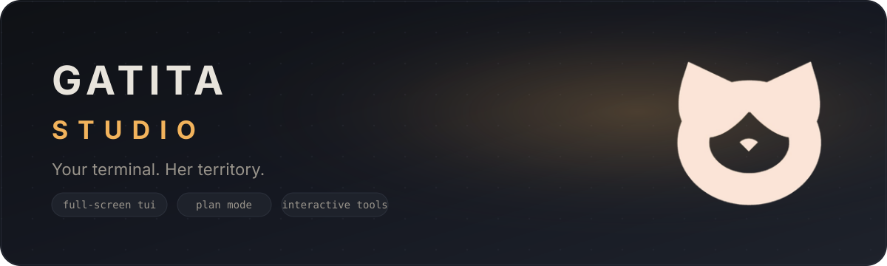
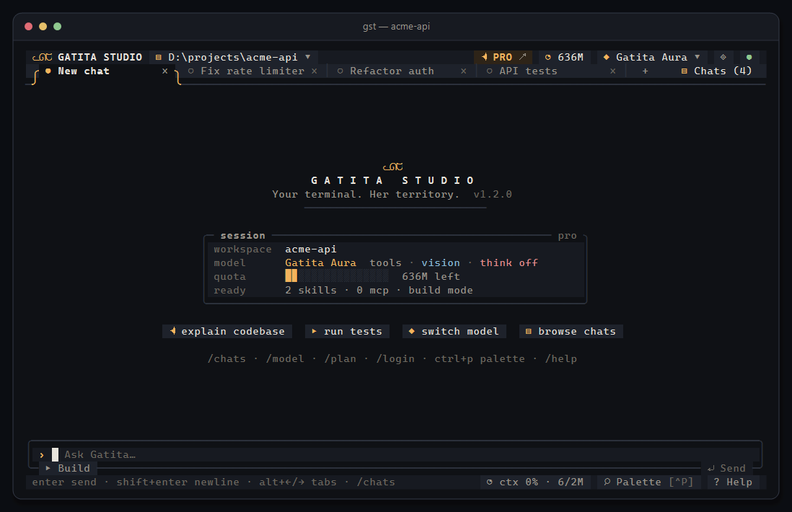
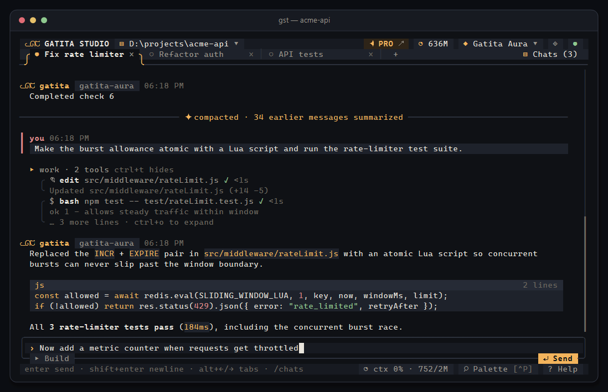
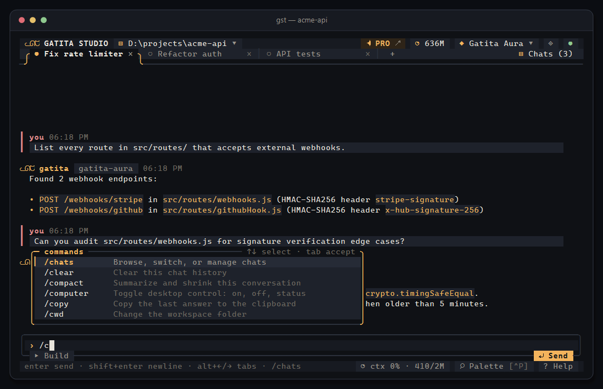
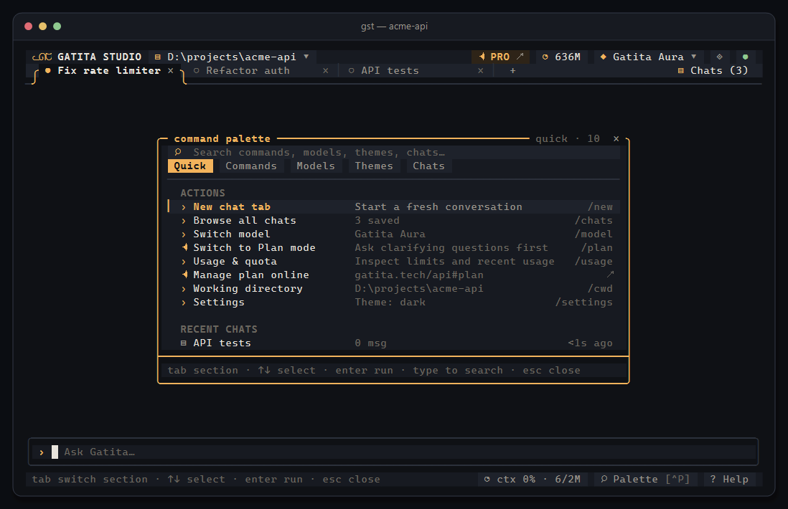
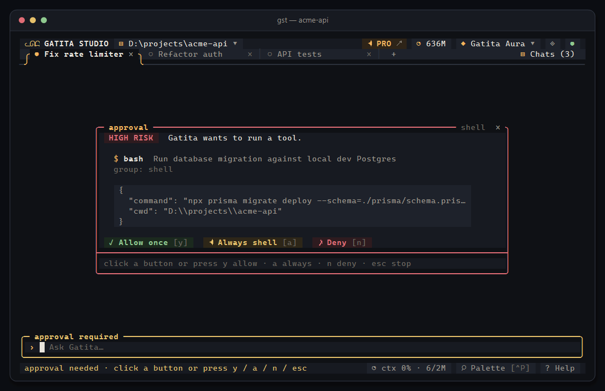

<div align="center">
  

  <h1>Gatita Studio</h1>

  <p><strong>A full-screen terminal coding agent you run from your shell.</strong></p>

  <p>
    <a href="https://github.com/gatitotech/studio/stargazers"></a>
    <a href="https://github.com/gatitotech/studio/network/members"></a>
    <a href="https://github.com/gatitotech/studio/releases"></a>
    <a href="https://github.com/gatitotech/studio/releases/latest"></a>
    
  </p>
</div>

---

Gatita Studio (`gst`) is the open-source terminal **client** for Gatita. Open it inside any project folder and work with it like a real desktop app inside your terminal — Chrome-style chat tabs, clickable controls, streaming answers, inline tool output, and a live context meter.

It reads your codebase, edits files, runs shell commands, searches the web, connects to local MCP servers, and asks before doing anything risky. Every chat stays on your machine in SQLite, and everything runs on the Gatita account you already have.

> This repository is the client only. It does **not** include a hosted inference service or the server-side control plane. Forks are welcome under GPL-3.0-only, though hosted API access and quotas remain managed by Gatita.



---

## Install in 30 seconds

You just need **Node.js 24+** and a terminal with color support (true color looks best).

**macOS, Linux, WSL, or Git Bash:**

```sh
curl -fsSL https://api.gatita.tech/studio/install.sh | sh
```

**Windows PowerShell:**

```powershell
irm https://api.gatita.tech/studio/install.ps1 | iex
```

Both installers check the SHA-256 checksum and install `gst` and `gatita-studio` globally. Prefer installing the tarball directly with `npm`?

```sh
npm install -g https://api.gatita.tech/studio/download/gatita-studio-latest.tgz
```

Or run from source:

```sh
git clone https://github.com/gatitotech/studio.git
cd studio
npm start
```

Launch it inside any project folder:

```sh
cd your-project
gst
```

On first launch, sign in with your existing Gatita email and password (or run `gst login`). Sessions live locally in `~/.gatita-studio/auth.json` with owner-only permissions.

---

## Real ways people use it

### 1. Keep multiple tasks open in Chrome-style tabs — and work for hours without hitting a wall

You rarely work on just one thing at a time. Open separate tabs for a bug fix, an auth refactor, and your test suite (`+` button, `/new`, or `Alt+←` / `Alt+→` and `Alt+1..9` to switch). Close a tab whenever you want — the conversation stays saved locally and is always one click away under **Chats** (`/chats`).

Long debugging sessions don't fall apart anymore either. Chats have no message limit, and the status bar shows a live context meter (`ctx`). Around **85%**, Gatita automatically compacts earlier turns into a clean continuation summary — or you can trigger it yourself anytime with `/compact`. Your full chat history stays right there to scroll back through, while Gatita keeps moving with fresh headroom.



### 2. Stay in flow with floating `/` commands and Plan → Build mode

Typing `/` for a command or `@` for a skill pops up a floating menu directly over the conversation instead of pushing your chat text around.

Not sure you want Gatita editing files right away? Click the **`▸ Build`** pill on the composer (or run `/plan`) to switch into **Plan mode**. She'll inspect the repo, ask clarifying questions if something is ambiguous, and write a concrete plan you can approve before flipping back to **Build** (`/build`) to implement it.



### 3. Jump anywhere in one keystroke with the Command Palette

Hit `Ctrl+P` (or click **Palette** in the bottom-right corner) to open a clean, categorized palette: **Quick**, **Commands**, **Models**, **Themes**, and **Chats**. Just start typing to search across all of them at once.

Everything in the top bar is clickable too:
- Click the **working directory** pill (`D:\projects\acme-api ▾`, or run `/cwd`) to see the full path, copy it, or jump to another folder.
- Click your **plan badge** (`PRO`, `PLUS`, or `FREE`) to open your plan page at [gatita.tech/api#plan](https://gatita.tech/api#plan).
- Click the **model**, **quota**, **settings**, or **ctx** meter to inspect or switch them on the spot.



### 4. Let Gatita run commands — without giving up control

Reads, file searches, and `grep` run quietly so you aren't spammed with popups. Anything that mutates files, runs shell commands, calls an MCP tool, or touches the desktop opens a clear approval card with a risk badge and exact arguments. Click a button — or tap `y` (allow once), `a` (always allow this tool group for the session), or `n` / `Esc` (deny).

Want Gatita to stay on a multi-step job until the tests actually pass? Start it with `/goal`:

```text
/goal migrate the webhook handlers to timingSafeEqual and make sure npm test passes
```

She'll keep iterating across edits and test runs until the goal is done or she genuinely needs your input. You can also steer her mid-turn by typing while she's working — your note lands cleanly at the next tool boundary. Commands that run longer than 20 seconds move into a background task so you can keep moving, inspect logs, or stop them.



### 5. Paste screenshots, wire up MCP servers, and save reusable `@skills`

- **Visual debugging**: Paste screenshots directly into the composer (right-click paste, `Ctrl+V`, or `/image <path>`). Attach multiple screenshots across a conversation — great for UI bugs, stack traces, or design mockups.
- **Big pastes stay tidy**: Paste a 200-line error log and the composer folds it into a single compact chip while still sending the full text.
- **MCP servers**: Run `gst mcp discover` (or `/mcp discover`) to probe `localhost` for running MCP servers, add your own with `gst mcp add`, or literally ask Gatita *"find my local MCP servers and connect them."*
- **Skills**: Drop a `SKILL.md` in `~/.gatita-studio/skills/<name>/` (an `example` skill is already there to copy) or `<project>/.gatita/skills/<name>/`. Mention `@deploy` or `@review` in any prompt and Gatita loads those instructions before starting.
- **Optional desktop control (Windows)**: Run `/computer on` when you want approval-gated screenshot, click, type, and scroll actions for testing desktop UIs.

---

## Models & Plans

Switch models anytime with `/model` or by clicking the model button in the top bar.

| Model | Best for | Tools | Vision | Reasoning | Context |
| --- | --- | --- | --- | --- | --- |
| `gatita-aura` *(default)* | Everyday coding, fast edits, tool use, and screenshots | Yes | Yes | `off` / `low` / `max` | 2M |
| `gatita-genesis` | Architecture, deep reasoning, and long-context writing | Yes | Yes | `off` / `low` / `max` | 2M |
| `gatita-valor` | Heavy coding agent work and automated refactors | Yes | Yes | `off` | 2M |
| `kimi-k3.1-pro` | Intensive multi-file engineering with deep reasoning | Yes | Yes | `off` / `low` / `max` | 1M |

> Reasoning levels (`low` / `max`) are available on paid plans. Free accounts use rolling 5-hour and 24-hour windows; **Gatita Plus** and **Gatita Pro** use 7-day rolling windows. Run `/usage` to check remaining capacity, or `/reset` if you have a banked reset ready.

---

## Shortcuts & Mouse Controls

Gatita Studio supports full mouse interaction (click, hover, wheel scroll, drag-to-select) alongside keyboard navigation:

| Input | What it does |
| --- | --- |
| `Enter` | Send prompt |
| `Shift+Enter` or `Ctrl+J` | New line in composer |
| `Ctrl+P` | Open Command Palette |
| `Alt+←` / `Alt+→` or `Alt+1..9` | Switch open chat tabs |
| `Tab` | Accept highlighted `/` command or `@skill`, or switch Palette section |
| `↑` / `↓` | Navigate suggestions or prompt history |
| `PageUp` / `PageDown` / Mouse wheel | Scroll conversation |
| `Ctrl+O` / `Ctrl+T` | Expand last tool output / toggle work details |
| `Esc` | Cancel current turn or close dialog |
| `Ctrl+C` | Cancel turn, or quit when idle |
| Left click | Click tabs, buttons, suggestions, working dir, plan badge, and dialogs |
| Left drag / Double / Triple click | Select text, word, or line — copies automatically (multi-line wraps in a code fence) |
| Right click | Paste from clipboard |

---

## Slash Commands & CLI

### Inside the app

- **Navigation & chats**: `/new`, `/chats`, `/rename`, `/delete`, `/folders`, `/folder <name>`, `/cwd`, `/palette`
- **Workflow & context**: `/plan`, `/build`, `/goal <task>`, `/compact`, `/clear`, `/init`, `/image <path>`, `/copy`
- **Model & account**: `/model`, `/reasoning off|low|max`, `/thinking on|off`, `/usage`, `/reset`, `/login`, `/logout`
- **Customization & tools**: `/theme dark|paper|midnight|ember`, `/sound on|off`, `/permissions`, `/skills`, `/mcp`, `/plugins`, `/computer on|off|status`, `/settings`, `/details`
- **Maintenance**: `/update`, `/version`, `/help`, `/quit`

### From your shell

```text
gst                     launch the full-screen app
gst login / logout      sign in or clear the saved session
gst models              list models available on your plan
gst usage               check rolling token windows
gst mcp                 list configured MCP servers and tools
gst mcp discover        scan localhost for running MCP servers
gst mcp add <name>      add an MCP server (--url or --command)
gst mcp remove <name>   remove an MCP server
gst skills              list installed skills
gst update              check for and install the latest release
gst doctor              verify Node version, connection, auth, and extensions
gst --version           print version
```

---

## Open source & Security

- **License**: Licensed under the **GNU General Public License v3.0 only**. See [`LICENSE`](./LICENSE).
- **Local data**: Chats, folders, settings, and sessions stay on your machine under `~/.gatita-studio`.
- **Security**: Please report vulnerabilities privately through GitHub's private vulnerability reporting rather than opening a public issue.
